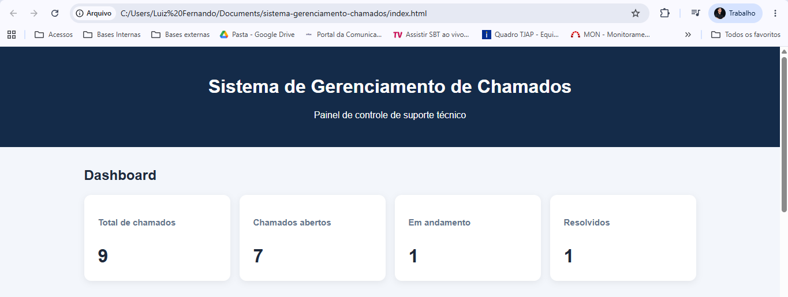
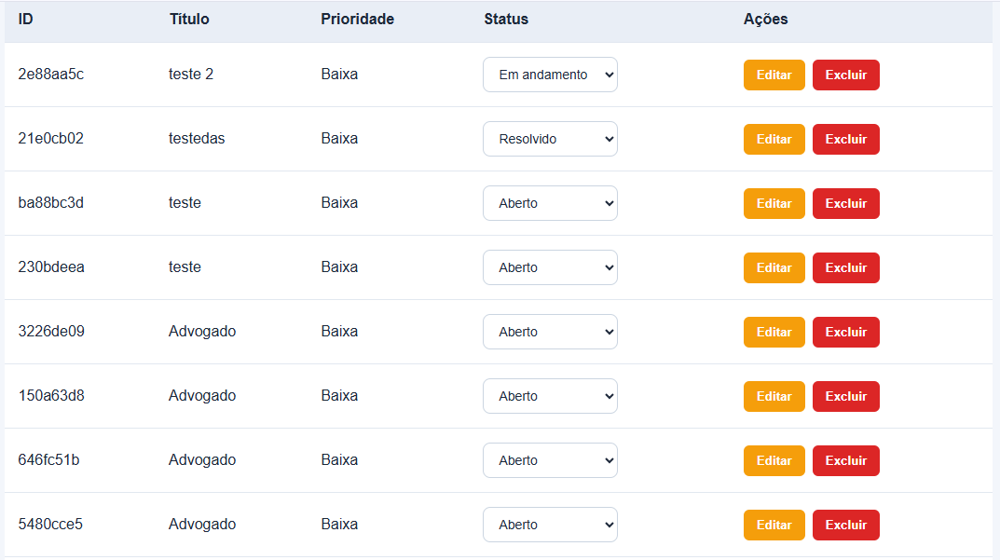

# Sistema de Gerenciamento de Chamados

Sistema web para cadastro e gerenciamento de chamados
de suporte técnico, desenvolvido como projeto de
portfólio em desenvolvimento de software.

## Sobre o projeto

A aplicação permite registrar, consultar, editar e
excluir chamados, além de acompanhar seus status
por meio de indicadores no dashboard.

O projeto foi desenvolvido com HTML, CSS e
JavaScript puro, utilizando localStorage para
persistência dos dados no navegador.

## Funcionalidades

- Cadastro de chamados
- Listagem de chamados
- Edição de título, descrição e prioridade
- Alteração de status
- Exclusão com confirmação
- Dashboard com indicadores
- Armazenamento local dos registros

## Tecnologias

- HTML5
- CSS3
- JavaScript
- Web Storage API (localStorage)

## Demonstração

O link para a versão online será adicionado após
a publicação no GitHub Pages.

## Como executar

1. Clone ou baixe este repositório.
2. Abra a pasta no Visual Studio Code.
3. Execute o arquivo index.html no navegador.
4. Cadastre um chamado para testar o sistema.

## Estrutura

- index.html — Interface da aplicação
- css/style.css — Estilos da interface
- js/app.js — Lógica e funcionalidades
- assets/screenshots — Imagens do projeto

## Limitações

Esta versão utiliza localStorage e não possui
autenticação, API ou banco de dados no servidor.

Os registros ficam armazenados localmente no
navegador e não são sincronizados entre dispositivos.

## Próximas melhorias

- Pesquisa e filtros de chamados
- Interface responsiva aprimorada
- API REST
- Integração com PostgreSQL
- Autenticação de usuários

## Autor

Luiz

GitHub: https://github.com/luizfsilva1705

## Capturas de tela

### Dashboard

### Cadastro de chamados

### Gerenciamento de chamados

